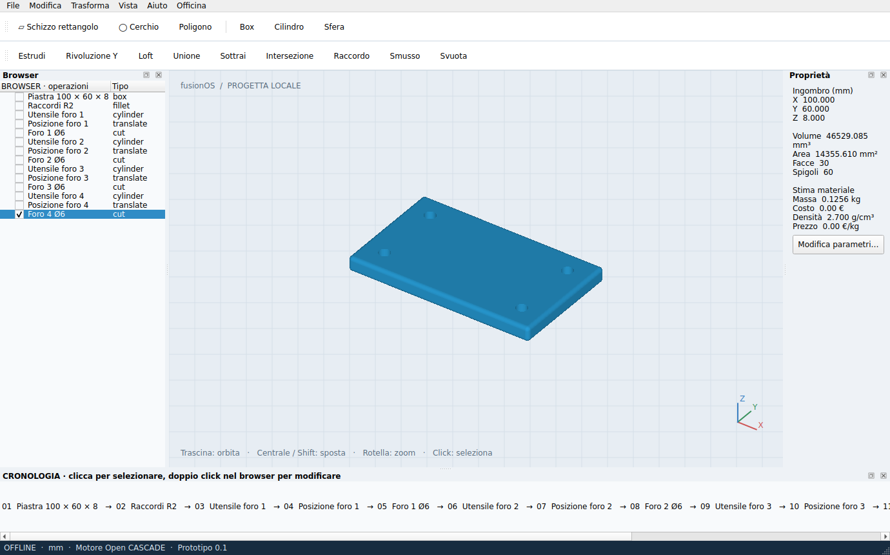

# fusionOS

**CAD desktop indipendente, open source, con funzionamento locale.**
Interfaccia ispirata al flusso di lavoro di Fusion: browser degli oggetti,
strumenti di modellazione, proprietà e cronologia in basso.

**Versione 0.1: prototipo funzionante, non un clone completo di Fusion 360.**
Non richiede FreeCAD, Fusion, un account Autodesk o una connessione durante l'uso.
Non incorpora codice o risorse Autodesk e non è affiliato ad Autodesk.



## Funzioni implementate

| Area | Disponibile |
| --- | --- |
| Schizzi | Rettangoli, cerchi e poligoni definiti numericamente, posizione XYZ |
| Solidi | Box, cilindro, sfera, estrusione, rivoluzione intorno a Y |
| Forme | Loft fra due profili a quote diverse |
| Booleani | Unione, sottrazione con scelta della base, intersezione |
| Finiture | Raccordi, smussi e svuotamento; selezione numerica di spigoli/faccia |
| Trasformazioni | Traslazione, rotazione X/Y/Z, specchiatura XY/XZ/YZ |
| Cronologia | Modifica parametri con ricostruzione delle dipendenze, annulla/ripeti |
| File | Progetti `.foscad`, import STEP, export STEP/STL/BREP |
| Visualizzazione | Orbita, spostamento, zoom, viste standard, selezione dei corpi |

Il motore **Open CASCADE, tramite CadQuery**, calcola geometrie BRep reali.
La mesh mostrata a schermo serve soltanto alla visualizzazione.

## Funzioni pratiche aggiuntive

- **Grezzo con sovrametallo:** volume rettangolare che segue l'ingombro del pezzo,
  con margine modificabile per lato.
- **Serie lineare:** da 2 a 100 copie, passo XYZ modificabile.
- **Varianti:** salva una copia del progetto e confronta ingombro e volume della
  stessa operazione dopo una modifica.
- **Stima materiale:** massa e costo a partire da densità e prezzo €/kg inseriti
  nelle impostazioni. Densità iniziale 2,7 g/cm³, prezzo iniziale zero; sono valori
  modificabili, non una distinta materiali o un preventivo di lavorazione.
- **Backup automatici locali:** ogni 2 minuti per impostazione iniziale; da 0
  (disattivati) a 60 minuti. Ultime 10 copie per sessione, nessuna sovrascrittura
  automatica del progetto originale. Recupero con File → Apri dalla cartella backup.
- **Qualità anteprima:** veloce, bilanciata o accurata. La precisione BRep rimane invariata.

Non si afferma che queste funzioni siano assenti in Fusion: sono strumenti
personalizzabili per il flusso di lavoro locale.

## Avvio Windows

Per la versione sorgente serve **Python 3.11 o 3.12 a 64 bit**.

1. Scarica **Code → Download ZIP** ed estrai tutto.
2. Esegui `Installa-Windows.bat` una volta. Questa fase scarica le dipendenze.
3. Esegui `Avvia-fusionOS.bat`. Dopo l'installazione puoi disattivare la rete.

Alternativa terminale, anche su Linux/macOS:

```bash
python -m venv .venv
# Windows: .venv\Scripts\activate
# Linux/macOS: source .venv/bin/activate
python -m pip install .
python -m fusionos
```

### Eseguibile senza Python installato

È incluso un workflow manuale **Actions → Windows experimental executable → Run workflow**.
Se la build riesce, produce l'artefatto `fusionOS-Windows-experimental` con `fusionOS.exe`
e le sue dipendenze. Va estratta e conservata **l'intera cartella**, non solo l'EXE.
La preparazione del workflow non significa che il binario sia già compilato,
collaudato su Windows o pubblicato come release. Verificare l'esito di Actions.

## Primo pezzo

1. Crea uno schizzo rettangolare (es. 60 × 40 mm).
2. Selezionalo nel browser e premi **Estrudi** (es. 10 mm).
3. Fai doppio click sullo schizzo e cambia la larghezza: l'estrusione si aggiorna.
4. Seleziona il solido e prova **Raccordo** con raggio 1 mm.
5. Nel menu **Officina**, crea un grezzo con 2 mm di sovrametallo.
6. Salva `.foscad` per mantenere la cronologia. Esporta STEP per usare il solido altrove.

Esempio pronto: `examples/piastra-cnc.foscad`, generato da `scripts/demo.py`.
Per i booleani usa Ctrl+click nel browser. I corpi sorgente vengono nascosti,
ma restano modificabili nella cronologia. La casella nel browser li rende visibili.

## Limiti espliciti della 0.1

- Non è la suite CAD completa di Fusion: mancano solver di vincoli di schizzo,
  disegno interattivo 2D, T-spline, sweep, assiemi vincolati, tavole e CAM.
- Schizzi su piani XY a Z variabile; rivoluzione solo intorno a Y globale.
- Raccordi/svuotamenti usano indici di spigoli e facce, non selezione grafica
  dei sottoelementi. Gli indici possono cambiare dopo modifiche a monte.
- Visualizzatore iniziale **CPU**, con depth buffer software. Non è destinato a
  scansioni pesanti; massimo 100.000 triangoli per corpo visualizzato.
- Ricostruzione sincrona: modelli grandi possono bloccare temporaneamente l'interfaccia.
- Nessun import della cronologia `.f3d`, nessuna trasformazione automatica mesh-solido.
- La serie lineare produce un insieme di solidi, senza unirli automaticamente:
  evitare copie sovrapposte quando si usa la stima del volume/materiale.
- La stima materiale è globale; non gestisce materiali diversi per corpo.
- Il confronto varianti mostra dimensioni e volume, non deviazioni tra superfici.
- Limite iniziale del progetto: 50 MiB e 1000 operazioni. Non usare per dati non fidati.

## Test

```bash
python -m unittest discover -s tests -v
```

I test usano il motore CAD reale: volumi, booleani, estrusione e ricostruzione,
loft, rivoluzione, finiture, trasformazioni, grezzo, serie, annulla/ripeti,
fallimento atomico, riapertura progetto, STEP round-trip e avvio GUI offscreen.
Vedi [rapporto iniziale](docs/VALIDATION.md) e risultati aggiornati in Actions.

## Sviluppo e licenza

Codice originale MIT. Le dipendenze mantengono le rispettive licenze.
Vedi [architettura](docs/ARCHITECTURE.md) e [roadmap](docs/ROADMAP.md).
Il progetto usa [CadQuery](https://github.com/CadQuery/cadquery),
[Open CASCADE](https://github.com/Open-Cascade-SAS/OCCT) e
[Qt for Python](https://doc.qt.io/qtforpython-6/).
